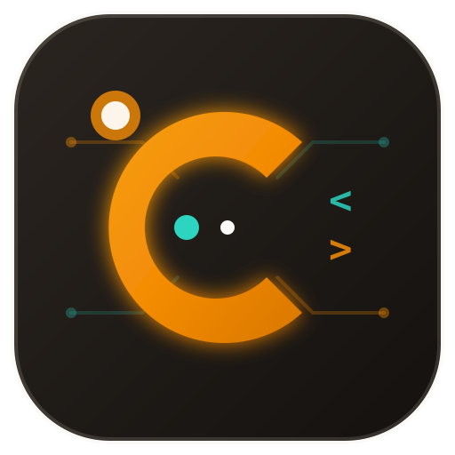

<p align="center">
  
</p>

<h1 align="center">The Complete C Engineering Academy</h1>

<p align="center">
  <strong>A full-spectrum, browser-native interactive platform engineered from scratch for mastering ISO C11 systems programming, silicon memory models, and low-level computer architecture.</strong>
</p>

<p align="center">
  <a href="https://nextjs.org/"></a>
  <a href="https://en.wikipedia.org/wiki/C11_(C_standard_revision)"></a>
  <a href="https://webassembly.org/"></a>
  <a href="LICENSE"></a>
  <a href="https://raghavendravarma.vercel.app/"></a>
</p>

---

## 📖 Table of Contents
- [Executive Overview](#-executive-overview)
- [System Architecture](#-system-architecture)
- [Core Interactive Laboratories](#-core-interactive-laboratories)
  - [1. 150-Level Progressive Silicon Curriculum](#1-150-level-progressive-silicon-curriculum)
  - [2. C Error Doctor & Diagnostic Lab](#2-c-error-doctor--diagnostic-lab)
  - [3. Multi-File Translation Unit Linker](#3-multi-file-translation-unit-linker)
  - [4. Visual C Block Studio](#4-visual-c-block-studio)
  - [5. Silicon Storyboard Execution Visualizer](#5-silicon-storyboard-execution-visualizer)
  - [6. Everyday Embedded Systems Simulator](#6-everyday-embedded-systems-simulator)
  - [7. Foundational Systems Engineering Models](#7-foundational-systems-engineering-models)
  - [8. Real-Time WebAssembly Compiler Sandbox](#8-real-time-webassembly-compiler-sandbox)
  - [9. 32 ISO C Keywords & Standard Library Compendium](#9-32-iso-c-keywords--standard-library-compendium)
  - [10. Global C Learning Ecosystem & Curated Paths](#10-global-c-learning-ecosystem--curated-paths)
- [Smart C Detective & Hidden Traps](#-smart-c-detective--hidden-traps)
- [Local Development & Quickstart](#-local-development--quickstart)
- [Deployment & GitHub Pages Hosting](#-deployment--github-pages-hosting)
- [Legal Clarity, Rights & Educational Disclaimer](#-legal-clarity-rights--educational-disclaimer)
- [Crafted With Coffee](#-crafted-with-coffee)

---

## 🌟 Executive Overview

**The Complete C Engineering Academy** is an original, production-grade learning platform built to demystify low-level software engineering. Rather than treating C as an abstract syntax exercise, the academy bridges high-level code with real silicon execution: stack frames, pointer registers, heap allocation, translation units, and hardware interrupts.

### Key Highlights
- **100% Client-Side WebAssembly Execution**: Compiles and executes real ISO C programs directly in the browser with dual fallback resilience for zero-backend hosting environments (such as GitHub Pages and static CDNs).
- **Interactive Silicon Telemetry**: Quantifies memory usage down to the byte and estimates CPU execution cycle counts for every program.
- **Unified Progression State**: Level selections and learning contexts stay seamlessly synchronized across all 10 specialized interactive views.
- **Real-World Practical Scenarios**: Replaced generic toy examples with authentic engineering challenges, domestic currency (`₹` / INR), and practical embedded hardware controllers.

---

## ⚙️ System Architecture

```text
+---------------------------------------------------------------------------------+
|                                USER INTERFACE                                   |
|   150-Level Journey | Error Doctor | Visual Blocks | Systems Lab | Encyclopedia |
+---------------------------------------------------------------------------------+
                                       |
                                       v
+---------------------------------------------------------------------------------+
|                       SYNCHRONIZED LEARNING CONTEXT                             |
|         Active Level (1-150) | Topic | Code Cache | Bananas Bank (Gamified)     |
+---------------------------------------------------------------------------------+
                                       |
                   +-------------------+-------------------+
                   |                                       |
                   v                                       v
+-------------------------------------+   +-------------------------------------+
|         C PREPROCESSOR / AST        |   |         DUAL RUNTIME ENGINE         |
|  - Comma struct member normalizer   |   |  Mode A: WebAssembly PicoC Worker   |
|  - Pointer truthiness normalization |   |  Mode B: Client-side Engine Fallback|
|  - Header guard validator           |   |  - Zero backend dependency needed   |
+-------------------------------------+   +-------------------------------------+
                                       |
                                       v
+---------------------------------------------------------------------------------+
|                             SILICON DIAGNOSTICS                                 |
|      Console Output Stream  |  RAM Footprint (Bytes)  |  CPU Clock Cycles       |
+---------------------------------------------------------------------------------+
```

---

## 🔬 Core Interactive Laboratories

### 1. 150-Level Progressive Silicon Curriculum
A comprehensive 5-tier engineering progression taking learners from elementary memory mechanics to advanced algorithmic data structures:

| Tier | Levels | Curriculum Focus | Practical Capstone Project |
| :--- | :---: | :--- | :--- |
| **Tier 1: Foundations & Silicon Memory** | 1–30 | Memory byte allocation, format specifiers, ASCII mapping, bitwise manipulation, operator precedence | Indian Kirana Store GST Billing Engine (`₹`) |
| **Tier 2: Decisions & Branching Dynamics** | 31–60 | `if-else` branches, jump tables (`switch-case`), nested loops, Euclidean GCD, prime sieve | Delhi Traffic Chowk Signal Controller |
| **Tier 3: Linear & Multidimensional Structures**| 61–90 | 1D/2D arrays, matrix transformations, string termination (`\0`), stack frame recursion | Academic Grade & Rank Analytics Engine |
| **Tier 4: Pointers, Heap Memory & Structs** | 91–120 | Address arithmetic, pass-by-reference, `malloc`/`free`, struct padding, byte packing | In-Memory Core Banking Transaction Ledger |
| **Tier 5: Data Structures, Algorithms & DAA** | 121–150 | Singly/Doubly Linked Lists, Queues, Stacks, Binary Trees, QuickSort, MergeSort, Hash Tables | Real-Time Hardware Sensor Queue & BST |

---

### 2. C Error Doctor & Diagnostic Lab
Engineered for mastering the art of troubleshooting realistic multi-bug codebases:
- **Large Production Files (50+ Lines)**: Diagnose and resolve 3 to 4 simultaneous bugs per challenge across real industrial scenarios (Indian Railway Ticket Reservation Systems, ICU Vital Signs Telemetry Monitors, Metro AFC Gateways).
- **Tri-Category Classification**: Teaches precise identification between **Compiler Syntax Violations**, **Linker Collisions**, and **Runtime Memory Faults** (`SIGSEGV`, uninitialized pointers, integer overflow).

---

### 3. Multi-File Translation Unit Linker
Visualizes how the C compilation pipeline separates translation units:
- **Header Files (`.h`) vs Implementation Files (`.c`)**: Demonstrates header guard idempotency (`#ifndef`, `#define`, `#endif`).
- **Variable Storage Durations**: Explains the difference between internal linkage (`static`) and external symbol resolution (`extern`).
- **Interactive Dependency Graph**: Live simulation of single translation unit compilation versus multi-object linker stages.

---

### 4. Visual C Block Studio
Dual visual construction environments bridging visual logic and native C syntax:
- **C Code Reassembly Puzzles**: Organize shuffled C statements into functionally correct algorithmic order to earn progression rewards.
- **Freeform Visual Block Lab**: Assemble programs using 35+ Lego-like modular blocks spanning 10 distinct language categories (Variables, Logic, Loops, Arrays, Strings, Functions, Pointers, Structs, IO). Generates clean, compilable ISO C11 code in real-time.

---

### 5. Silicon Storyboard Execution Visualizer
Step-by-step instruction visualizer showing exact hardware states at each phase of execution:
- Inspect CPU Registers (`RBP`, `RSP`, `RAX`).
- Visualize Stack Frame growth, variable scope transitions, and memory address mapping.
- Observe pointer dereferencing and heap allocations in a live memory diagram.

---

### 6. Everyday Embedded Systems Simulator
Interactive simulators modeling embedded microcontrollers powering real-world machines:
- **Fully Automatic Washing Machine**: Cycle sequencing, water level sensors, and motor speed PWM control.
- **Microwave Oven Controller**: Magnetron timing, safety door switch interlocking, and thermal duty cycles.
- **Drone Flight Stabilization**: IMU pitch/roll/yaw telemetry processing and motor thrust equalization.
- **Intelligent Traffic Junction**: Pedestrian crossing priority interrupts and peak-hour density scheduling.

---

### 7. Foundational Systems Engineering Models
Compilable, educational reference implementations written from scratch to illustrate computer systems foundations:
- **In-Memory Key-Value Store**: Demonstrates dynamic string memory allocation, key hashing, and $O(1)$ fast lookups.
- **Content-Addressable Storage Engine**: Models cryptographic blob hashing and immutable tree indexing.
- **Preemptive Operating System Scheduler**: Simulates process control blocks (PCBs), priority scheduling, and round-robin CPU quantum slicing.
- **Database Fixed-Size Paging Engine**: Implements binary disk page layout, schema record serialization, and file I/O offset mathematics.
- **3D Raycasting Engine**: Interactive mathematical models illustrating projection planes, vector trigonometry, and fast inverse approximation techniques.

---

### 8. Real-Time WebAssembly Compiler Sandbox
- In-browser code editor with instant compilation and execution.
- Interactive standard input (`stdin`) allowing live console data entry for `scanf`, `fgets`, and `getchar`.
- Telemetry readout tracking dynamic byte allocation and CPU execution cycles.

---

### 9. 32 ISO C Keywords & Standard Library Compendium
- **32 Standard ISO Keywords**: Exhaustive architectural breakdown covering assembly mappings, silicon implications, best practices, and common misconceptions.
- **Standard Library Modules**: Complete API specifications and runnable examples for `<stdio.h>`, `<stdlib.h>`, `<string.h>`, `<math.h>`, `<ctype.h>`, `<time.h>`, `<stdbool.h>`, and `<stdint.h>`.
- **Preprocessor Macro Guide**: Deep explanations of `#define`, `#include`, `#pragma`, header inclusion safety, and token concatenation.

---

### 10. Global C Learning Ecosystem & Curated Paths
Curated directory linking learners to 18 reputable open learning platforms organized across 4 learning phases:
- **Phase 1: Visual & Algorithmic Logic**: CodeMonkey, Code.org, Google Blockly Games.
- **Phase 2: Zero-Install Online Compilers**: Programiz Compiler, CodeChef IDE, W3Schools Practice, WayToC, PythonTutor C Visualizer, OnlineGDB, Compiler Explorer (Godbolt).
- **Phase 3: Formal Concept References**: W3Schools C, Programiz C Reference, Learn-C.org, DataCode C, cppreference.com.
- **Phase 4: Problem Solving & Competitive Tracks**: CodeChef Practice Track, HackerRank C Domain, Exercism C Track, LeetCode C.

---

## 🕵️‍♂️ Smart C Detective & Hidden Traps
An interactive challenge suite designed to train engineering vigilance against subtle C traps:
- Accidental assignment inside conditional checks (`if (x = 5)`).
- Dangling `else` ambiguities.
- Integer division truncation (`5 / 2 == 2`).
- String array sizing omissions omitting the null terminator (`\0`).
- Macro expansion operator precedence traps (`#define SQUARE(x) x * x`).

---

## 🚀 Local Development & Quickstart

### Prerequisites
- Node.js 18.x or higher
- npm 9.x or higher

### Installation
```bash
# Clone the repository
git clone https://github.com/raghavendravarma/c-engineering-academy.git
cd c-engineering-academy

# Install dependencies
npm install

# Start the local development server
npm run dev
```

Open [http://localhost:3000](http://localhost:3000) in your browser to start exploring the academy.

### Building for Production
```bash
npm run build
npm run start
```

---

## 🌐 Deployment & GitHub Pages Hosting

The application is engineered to deploy seamlessly on static hosting services (such as **GitHub Pages**, **Vercel**, and **Netlify**).

1. In `next.config.ts`, verify the configuration is set for static export (`output: 'export'`) when targeting GitHub Pages.
2. Run the build pipeline:
   ```bash
   npm run build
   ```
3. The standalone production bundle is compiled directly to the `out/` folder, ready for deployment.

---

## ⚖️ Legal Clarity, Rights & Educational Disclaimer

- **100% Original Codebase**: This application, its educational curricula, visual block abstractions, diagnostic laboratories, and source code examples were conceptualized, architected, and authored from scratch as an original open-source educational platform.
- **Open-Source License**: All code within this repository is distributed under the liberal [MIT License](LICENSE), allowing free use, modification, and distribution for learning and development.
- **Educational Fair Use Notice**: Any references to historical architectures, operating systems, or landmark software paradigms (such as Redis, Git, Linux, or SQLite) are simplified educational models written independently from first principles for pedagogical comparison under fair use. All respective trademarks and service marks belong to their legal owners.

---

## ☕ Crafted With Coffee

Architected, designed, and developed with lots of ☕ coffee by:

<p align="left">
  <strong>Raghavendra Varma</strong><br />
  Portfolio & Engineering Works: <a href="https://raghavendravarma.vercel.app/">https://raghavendravarma.vercel.app/</a>
</p>
